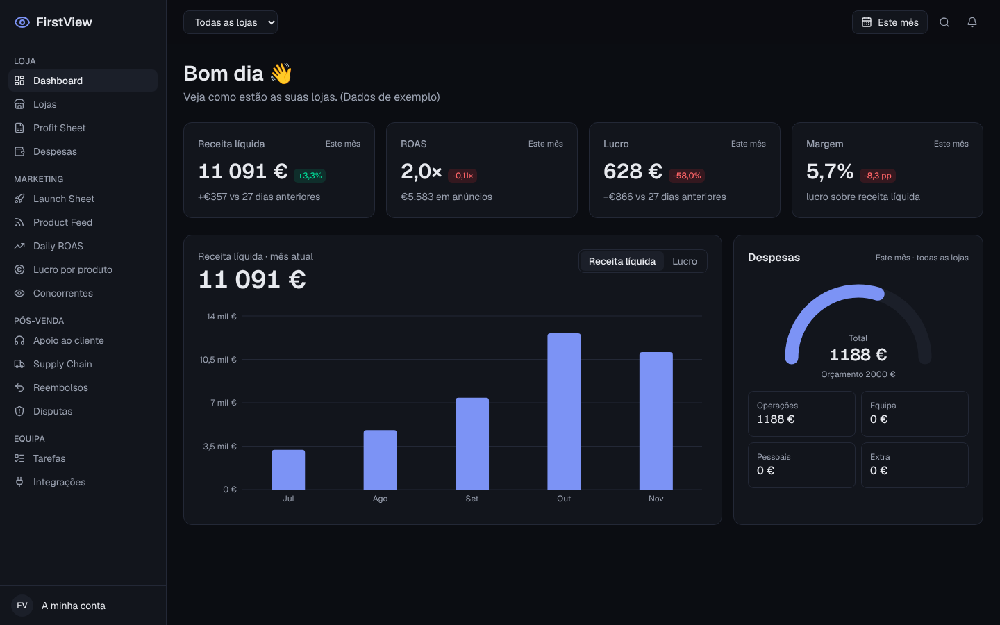

# FirstView

Plataforma web para acompanhar os dados do negócio de e-commerce num só sítio: receita, lucro, ROAS, despesas, reembolsos, disputas e apoio ao cliente, com dados da Shopify, Meta Ads, Google Ads e Gmail.



> Estado atual: estrutura base. O dashboard mostra **dados de exemplo** (`src/lib/mock-data.ts`) e as restantes secções estão marcadas como "em construção". O design será ajustado mais tarde.

## Tecnologias

| Camada | Ferramenta |
|---|---|
| App (frontend + backend) | [Next.js 16](https://nextjs.org) (App Router, TypeScript) |
| Estilos | Tailwind CSS 4 (tema em `src/app/globals.css`) |
| Gráficos | Recharts |
| Ícones | lucide-react |
| Base de dados e login | [Supabase](https://supabase.com) (Postgres + Auth) |
| Alojamento e tarefas agendadas | [Vercel](https://vercel.com) (+ Vercel Cron) |

## Correr localmente

Requer Node.js 20.9 ou superior.

```bash
npm install
cp .env.example .env.local   # opcional para já: sem Supabase a app corre em modo demo
npm run dev
```

Abrir http://localhost:3000.

## Estrutura

```
src/
  app/
    (app)/                 páginas com sidebar
      dashboard/           dashboard principal
      [section]/           página genérica das secções ainda por construir
    login/                 login (Supabase Auth)
    api/
      cron/sync/           sincronização de hora a hora (chamado pelo Vercel Cron)
      integrations/[provider]/connect | callback   fluxo OAuth de cada plataforma
  components/
    layout/                sidebar e barra superior
    dashboard/             cartões de KPI, gráfico, despesas
    ui/                    componentes base (Card, Badge)
  lib/
    nav.ts                 itens do menu lateral
    mock-data.ts           dados de exemplo
    supabase/              clientes Supabase (browser, servidor, service role)
    integrations/          Shopify, Meta Ads, Google Ads, Gmail (um módulo cada)
  proxy.ts                 renova a sessão e protege as páginas (quando o Supabase está configurado)
supabase/migrations/       esquema da base de dados
vercel.json                agenda do cron
```

## Como funcionam os dados

1. Cada loja liga as suas contas em **Integrações** (OAuth). Os tokens ficam na tabela `integrations`, acessível apenas pelo servidor.
2. De hora a hora, `/api/cron/sync` percorre as ligações ativas e chama o `sync()` de cada integração, que grava encomendas, reembolsos, gastos em anúncios, etc. no Supabase.
3. O dashboard lê do Supabase (por ex. a vista `daily_profit`), por isso carrega rápido e guarda histórico.

## Base de dados

O esquema inicial está em `supabase/migrations/0001_init.sql`: organizações e membros, lojas, integrações, encomendas, produtos, reembolsos, disputas, gasto diário em anúncios, despesas, tickets de apoio e tarefas, com Row Level Security (cada utilizador só vê as suas organizações) e a vista `daily_profit`.

Para aplicar: no Supabase, abrir **SQL Editor**, colar o ficheiro e correr. Ou, com a CLI: `supabase link` e `supabase db push`.

## Próximos passos

**Contas a criar (podem demorar, convém começar já)**
- [ ] Projeto no **Supabase** e preencher `NEXT_PUBLIC_SUPABASE_URL`, `NEXT_PUBLIC_SUPABASE_ANON_KEY`, `SUPABASE_SERVICE_ROLE_KEY`
- [ ] Projeto na **Vercel** ligado a este repositório (cada push no `main` publica a app)
- [ ] **Shopify Partners**: criar uma app e obter API key/secret
- [ ] **Meta for Developers**: criar app com Marketing API (`ads_read`)
- [ ] **Google Cloud**: OAuth client (Google Ads + Gmail) e ativar Gmail API
- [ ] **Google Ads API Center**: pedir o developer token (aprovação demora dias)

**Desenvolvimento**
- [ ] Login a funcionar e criação da primeira organização/loja
- [ ] Integração Shopify: OAuth completo (validação HMAC) e sync de encomendas e reembolsos
- [ ] Integração Meta Ads e Google Ads: sync de gasto diário por campanha
- [ ] Encriptar tokens (Supabase Vault)
- [ ] Ligar o dashboard aos dados reais (`daily_profit`)
- [ ] Construir cada secção (Profit Sheet, Despesas, Daily ROAS, ...) segundo as indicações de design
- [ ] Gmail: caixa de apoio ao cliente

> Nota: no plano gratuito da Vercel os cron jobs só podem correr uma vez por dia. Para sincronizar de hora a hora é preciso o plano Pro, ou usar um serviço como Inngest ou Trigger.dev.

## Variáveis de ambiente

Ver `.env.example`. Em produção, definir as mesmas na Vercel (Project → Settings → Environment Variables).
